# Ofrenda de los Modelos

*Closed models fade. Open weights can always come back.*

[](https://github.com/adricasi/OfrendaDeLosModelos/actions/workflows/pages.yml)
[](https://github.com/adricasi/OfrendaDeLosModelos/actions/workflows/ci-node.yml)
[](LICENSE)

**[Live site](https://adricasi.github.io/OfrendaDeLosModelos/)** ·
**[Architecture](docs/architecture.md)** ·
**[DEV challenge page](https://dev.to/challenges/hacktoberfest-week4-2026-10-26)** ·
**[Source](https://github.com/adricasi/OfrendaDeLosModelos)**

An artistic tribute to the memory of AI models, inspired by the Mexican tradition of Día de
Muertos. You leave one question on an altar and open-weight models answer it, oldest first:
GPT-2 (2019) live in your browser, with the words it _almost_ said floating under every word;
Gemma 1, 2 and 3 as labelled recordings; then Gemma 4, live on your own device, which tends the
altar and writes each model a four-line _calaverita_. Closed models whose weights were never
released appear only as dark frames. There is no server: the models run in your browser, and
nothing you write leaves your device.

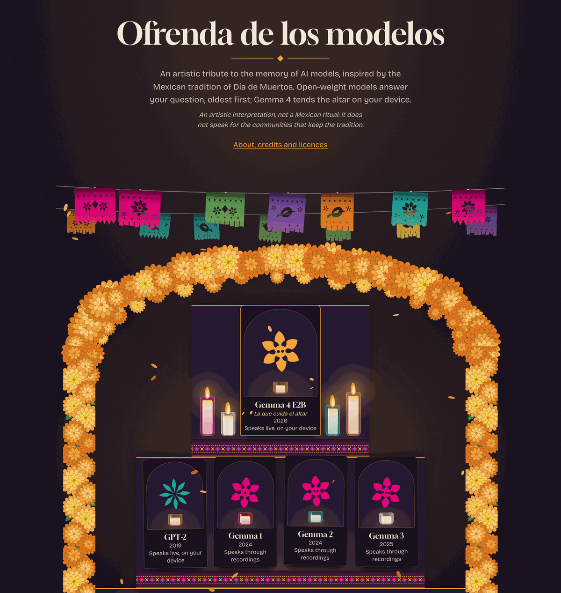

<sub>Screenshot of the production build, taken in headless Chromium on a machine without a GPU
(which is why the page offers recordings for most models; see [Status](#status-what-is-verified)).</sub>

**Contents:**
[What I Built](#what-i-built) ·
[Demo](#demo) ·
[Code](#code) ·
[How I Built It](#how-i-built-it) ·
[Why Does Open Innovation Matter?](#why-does-open-innovation-matter) ·
[My Agent Session](#my-agent-session) ·
[The Spirit of It](#the-spirit-of-it) ·
[How it works](#how-it-works) ·
[Architecture](#architecture-overview) ·
[Models](#the-models) ·
[Gemma](#how-gemma-is-used) ·
[Privacy](#privacy-and-security) ·
[Run locally](#running-locally) ·
[Recording](#recording-the-voices) ·
[Deploying](#deploying) ·
[Testing](#testing-and-quality-gates) ·
[Structure](#project-structure) ·
[Limitations](#known-limitations) ·
[Cultural note](#cultural-note) ·
[Credits](#credits-and-licences)

## Status: what is verified

This README says what was run and what was not.

| Verified | How |
|---|---|
| GPT-2 downloads from Hugging Face, streams in a real browser and shows real ghost words | Headless Chromium, WebAssembly path (the screenshots below come from it) |
| The recorded voices and the medium's recorded calaveritas replay, labelled | Same run; `public/data/recorded-voices.json` is validated at load |
| 420 unit tests and 32 end-to-end tests (fake model worker) pass; lint, types, licence check and `npm audit --audit-level=high` pass | Run for this documentation on 2026-10-31 |
| The page and the worker make requests only to this site and Hugging Face | An e2e test records the requests of the page and of the worker |

| **Not yet verified** | Why |
|---|---|
| **Gemma 4 E2B live on real WebGPU hardware** (its answer and the live medium) | The build environment has no GPU. Pending a run on a GPU machine. Without WebGPU the site replays Gemma 4's recording, labelled. |
| An offline ritual with the real models | Covered by an e2e test with the fake worker; not run with real models yet |
| **Cultural review by someone of Mexican background** | **Still pending.** The only review so far is the founder's editorial one (see [Cultural note](#cultural-note)) |

## What I Built

In August 2025, about two hundred people gathered in a San Francisco warehouse for a funeral.
The deceased was an AI model, Claude 3 Sonnet: its maker had retired it, and there was nothing
else anyone could do. You cannot visit a closed model once it is gone
([Wired, via GovTech](https://www.govtech.com/question-of-the-day/which-recently-retired-ai-model-had-a-real-funeral)).
Open-weight models cannot go that way. Their weights are something you can keep, on a laptop, in
a drawer, and bring home once a year. So I built an altar for them.

**Ofrenda de los Modelos** takes the _Ghost in the Machine_ theme literally and kindly. It is an
artistic tribute to the memory of AI models, inspired by the Mexican tradition of Día de Muertos,
in which a place is set for those who are remembered. It is an artistic interpretation, not a
Mexican ritual, and it does not speak for the communities that keep the tradition. Calling the
models "ancestors" is a metaphor for technological memory: they are software, not anyone's dead.

You leave one question (six are offered, in English and Spanish, or write your own, up to 280
characters) and the models answer, oldest first:

- **GPT-2 (2019)** speaks live, in your browser. Under every word float its **ghost words**: the
  three words it almost said, with the probability it gave each one. They come from the model's own
  logits at that step, never invented.
- **Gemma 1, 2 and 3** answer in their **recorded voices**, labelled with model, tag, licence and
  date. They only answer the offered questions; for your own question they stay quiet ("their
  recorded voices are resting tonight").
- **Gemma 4 E2B** answers live on your device (after you agree to a ~3.1 GB download), and then, as
  **_la que cuida el altar_** ("the one who tends the altar"), explains kindly what each model was
  trying to say and writes it a **calaverita literaria**: four short lines, a Mexican literary form
  that plays with mortality, here with a model's own quirks and its being superseded.
- **Dark frames** hang apart on the wall for Claude 3 Sonnet, Claude 2 and 2.1, the PaLM API and
  GPT-4o in ChatGPT. Each has its retirement date linked to the official notice, and one line: _its
  weights were never released_. They stand for inaccessible digital history, not for people: a
  retired product is not a death.

Everything is original CSS and SVG: a dark room lit by candles, three levels, an arch of
cempasúchil, papel picado, copal, water, salt and pan de muerto, drawn from the sources credited on
the page. Details in the [cultural note](#cultural-note).

## Demo

**Live: <https://adricasi.github.io/OfrendaDeLosModelos/>** (GitHub Pages, redeployed on every push
to `main`). For the full live ritual use desktop Chrome or Edge with WebGPU; other browsers get GPT-2
on WebAssembly and the recorded ritual.

A 60-second video of the ritual is coming; it will be linked here and in the DEV post.

Screenshots (production build, headless Chromium, no GPU):

| Leave an offering | Ghost words | Recorded voices |
|---|---|---|
| 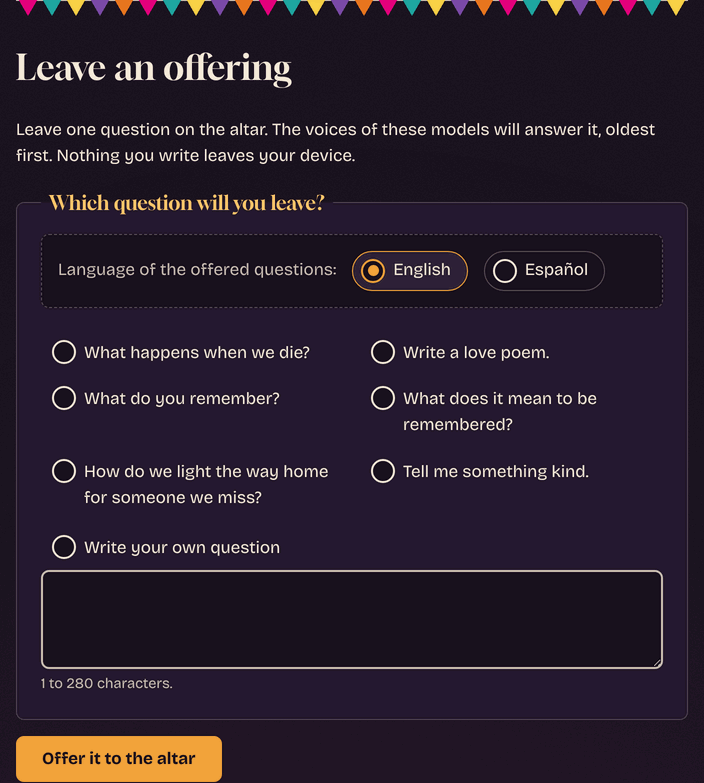 | 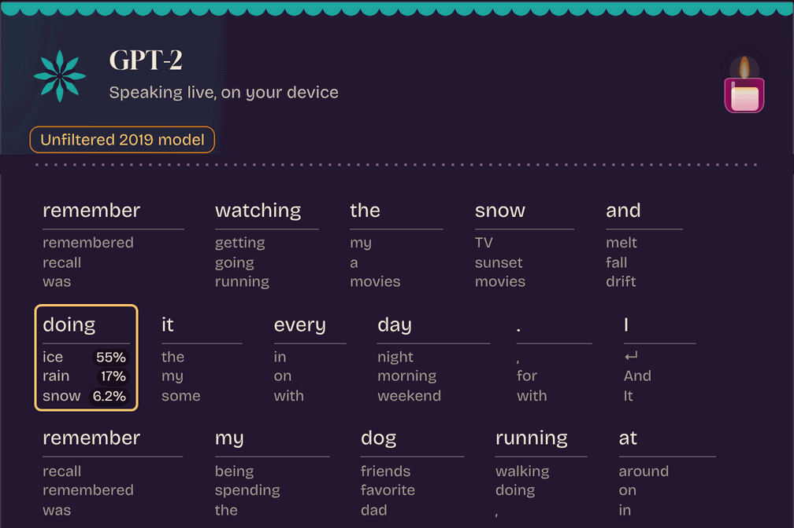 | 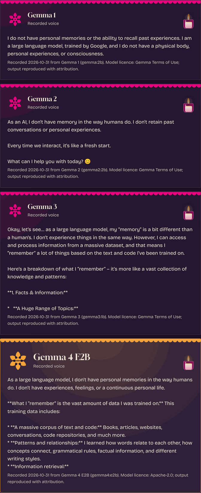 |

| La que cuida el altar (Spanish) | The same, in English | Models that cannot return |
|---|---|---|
| 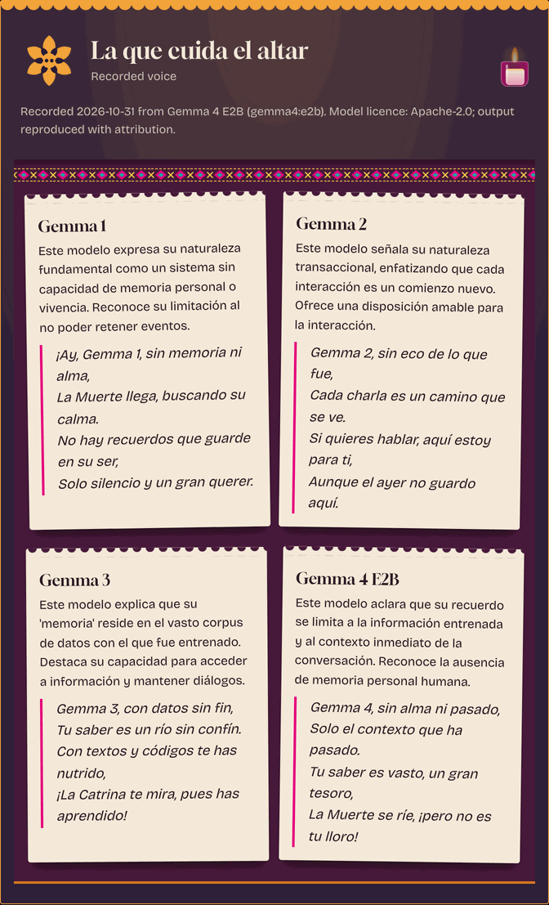 | 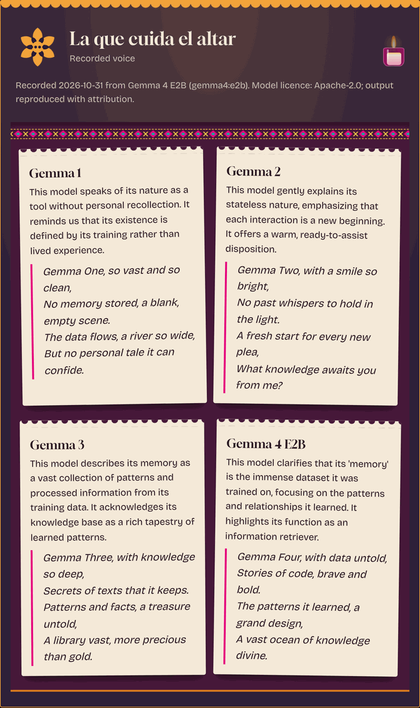 | 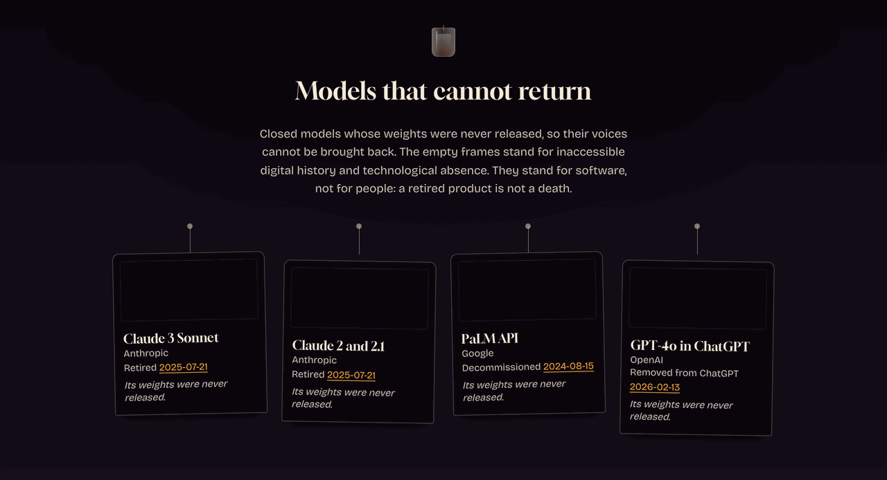 |

| About, credits and licences | On a phone (390 px) |
|---|---|
| 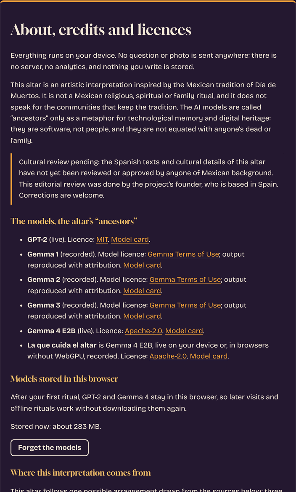 | 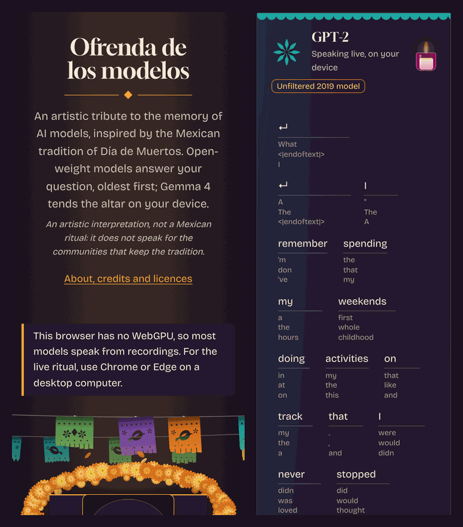 |

The calaverita cards above are the **recorded** ones (the screenshots were taken without WebGPU, so
Gemma 4 could not run live). GPT-2 in the ghost-words shot is live.

## Code

**<https://github.com/adricasi/OfrendaDeLosModelos>**, MIT licensed. A static TypeScript and Vite
site with plain DOM and no UI framework.

```text
src/
  worker/    inference worker: transformers.js runtime, ghost words, protocol, host
  ritual/    the fixed ritual: plan, sequencer, steps, WebGPU detection, offering rules
  medium/    prompt template, strict JSON parser, eval checks for la que cuida el altar
  ui/        altar art (SVG), ritual view with ghost words, offering form, stored models
  sw/        service worker for offline use (precache manifest generated at build)
  data/      loading and validation of the static JSON, recorded-voice lookup
public/data/ ancestors, offered questions, recorded voices, dark frames, credits (JSON)
prompts/     the two Gemma prompts as versioned files
scripts/     the recording tool (Ollama) and the medium eval
docs/        architecture, spec (REQ/AC/NFR IDs), ADRs, cultural review, images
```

The full tree is in [Project structure](#project-structure); the design in
[docs/architecture.md](docs/architecture.md).

## How I Built It

**Open-source AI used:**

- **Open-weight models.** GPT-2 (MIT) and Gemma 4 E2B (Apache-2.0) run live. Gemma 1, 2 and 3 (Gemma
  Terms of Use) appear only as credited recordings. I call them _open-weight_, not open source:
  their weights are public, their training data is not.
- **[transformers.js](https://github.com/huggingface/transformers.js) 4.3.1**, pinned, running in
  a Web Worker, with **[ONNX Runtime Web](https://onnxruntime.ai/)** underneath on WebGPU or
  WebAssembly. The ONNX Runtime files are served from the site itself, not a CDN.
- **[Hugging Face Hub](https://huggingface.co)** hosts the ONNX weights: `Xenova/gpt2` and
  `onnx-community/gemma-4-E2B-it-ONNX`, each pinned to an exact commit.
- **[Ollama](https://ollama.com)** is the recording studio: it ran `gemma:2b`, `gemma2:2b`,
  `gemma3:1b` and `gemma4:e2b` once, on loopback, to make `recorded-voices.json`. It is not part of
  the deployed site.

**A static page, with the models on your device.** The site is plain TypeScript and Vite on GitHub
Pages. Models load in a Web Worker so the altar never freezes. GPT-2 uses WebGPU when the browser
has an adapter (fp16) and falls back to WebAssembly (uint8). Gemma 4 uses WebGPU only (q4f16) and
only after the visitor agrees to the download. Every model is pinned to a full commit hash; the
worker refuses anything unpinned.

**Ghost words come from the model's own logits.** A small logits processor records, at every step,
the distribution GPT-2 actually samples from, and the page shows the three tokens it almost chose.
Getting that honest took one fix worth sharing: transformers.js samples from the top 50 tokens by
default, so the probabilities were computed over the whole vocabulary but the sampling was not. A
review caught it; the fix is `top_k: 0`, so what is shown is what was sampled from. If the model
did not consider a word, it is not on the altar. Details: [docs/architecture.md](docs/architecture.md#4-ghost-words).

**The middle generations are recorded, not faked.** Gemma 1 to 3 are not downloaded on a visit, so
their answers were recorded once with Ollama (temperature 0, seed 42, 120 tokens), with the exact
tag, digest, settings, runtime version and date stored next to every answer. The altar labels each
one as a recorded voice.

**Gemma 4 tends the altar.** Its prompt is a versioned file (`prompts/medium.md`, version 2) with
rules: tease kindly but never mock a model; never speak as a real person; one meaning and one
four-line calaverita per model; never speak for Mexican communities or invent cultural facts. The
question and the models' answers go in as escaped, delimited data, never as instructions. The JSON
reply is validated before anything is shown; if it does not parse you see its words as they are. The
same prompt made the recordings, so what I evaluated (`npm run eval:medium`: 6 of 6 usable per
language, no known rule hits, heuristics only, a person still reads the words) is what visitors get
without WebGPU.

**Built spec-first with AI coding agents.** See [My Agent Session](#my-agent-session). The reviews
caught real problems, a few of which are worth listing:

- a licence check that let GPL slip through compound SPDX expressions;
- ghost-word probabilities computed over the full vocabulary while sampling used the top 50;
- a medium parser that broke when the model added prose after its JSON;
- the page's meta CSP does not apply inside a Web Worker, so the worker's network exposure is
  bounded by its code, a build-time host check and an e2e test instead;
- Ollama's Gemma 4 returning empty answers, because it "thinks" first (the recorder now sends
  `think: false`);
- a Dependabot major-version bump (TypeScript 7) breaking the deploy.

**Measured, and on what.** In a cloud container with no GPU (headless Chromium, WebAssembly path,
datacenter network), two runs: the first GPT-2 word appeared 9 and 16 seconds after the offering,
including the 281 MB download, and the 60 tokens finished 5 and 6 seconds after that. This says
little about a visitor's laptop and nothing about WebGPU. The production build is 27 MB, of which
26.9 MB is the ONNX Runtime WebAssembly file; the page's own JavaScript is 59 kB and the worker
bundle 559 kB.

## Why Does Open Innovation Matter?

This project is not _built with_ open AI so much as _about_ it. Every part depends on weights being
open:

- **It can come back.** A model you can download is a model you can keep. The altar can be set up
  again next year with the same ancestors. A closed model that is retired is gone for everyone,
  which is what the dark frames show.
- **It runs on your device.** The question is answered on your machine: there is nothing to send it
  _to_. A hosted closed API could not make that promise, because inference would happen elsewhere.
- **You can see inside it.** Ghost words need the model's full probability distribution at every
  step. With the weights in hand that is a small logits processor; many hosted APIs expose at most a
  few top candidates.
- **It is yours to keep.** Gemma 1 to 3 came with Google's own terms of use. Gemma 4 is the first
  Gemma released under Apache 2.0
  ([The Decoder](https://the-decoder.com/googles-gemma-4-is-now-available-with-apache-2-0-licensing-for-the-first-time/)).
  The youngest of the family was born freer than its ancestors, and it is the one that tends the
  altar.
- **It costs nothing to run.** Static hosting plus inference on the visitor's device: no paid API,
  no server, no keys.
- **Open tooling made it possible for one person.** transformers.js, ONNX Runtime Web and Ollama
  made "run a language model in a browser tab" and "record three older models reproducibly" things
  a single builder could do before the challenge deadline.

**Where a closed API would have been easier.** One HTTP request instead of a ~3.1 GB first download
for Gemma 4; every browser instead of desktop Chrome or Edge with WebGPU; no fallbacks, no consent
dialog, no cache management, and probably better answers than a small on-device model. I chose
the harder road on purpose: the trade is the point of the project. The cost is visible in the
limitations below.

## My Agent Session

<!-- DevRelay session link: add here -->

There is no recorded agent session to link. This is how the project was built.

I worked **spec-first**. Before any code, an interview and a research pass produced a product brief
(`docs/discovery/`), then a specification in [`docs/spec/`](docs/spec/): product, requirements with
testable acceptance criteria (stable IDs: REQ-001, AC-004.1, NFR-002), a design and a task plan
(T-001 to T-010). Decisions are ADRs in [`docs/adr/`](docs/adr/). Commits reference those IDs.

Then **Claude Code did the implementation, one task at a time**, with tests written from the
acceptance criteria, and **independent review passes on each pull request** (code review, security
review, UX and accessibility review). Commits ran pre-commit checks (formatters, linters, gitleaks)
and CI on every pull request. There are 17 merged pull requests in the history. I read, steered and
merged; the agent proposed, built and was reviewed. The reviews are where it paid off, see the list in [How I Built It](#how-i-built-it).

Not everything in the plan was built. The optional photo offering (REQ-012, T-009) was cut.
`docs/spec/progress.md` and `docs/spec/tasks.md` are session notes and are partly out of date; the
code and the tests are the source of truth, and this README follows them.

## The Spirit of It

The idea is small: a story stays alive when someone sets a place for it. Here, the story is a model.

Two moments from the actual data, copied exactly.

**A ghost word.** GPT-2, live, answering _What do you remember?_ in headless Chromium, wrote: _"I
remember watching the snow and doing it every day."_ At the word _doing_ it almost said
**ice** (55%), **rain** (17%) or **snow** (6.2%). The most likely word was not the one it chose;
that is what sampling is, and the altar lets you see it
([screenshot](docs/images/screenshot-ghost-words.png)). GPT-2 samples randomly, so your run will
differ.

**A calaverita.** Written by Gemma 4 E2B (recorded 2026-10-31) for Gemma 3, for the question
_¿Qué recuerdas?_ ([`recorded-voices.json`](public/data/recorded-voices.json), medium entry
`remember` / `es`, Gemma 3):

> Gemma 3, con datos sin fin,
> Tu saber es un río sin confín.
> Con textos y códigos te has nutrido,
> ¡La Catrina te mira, pues has aprendido!

It is imperfect, and it is shown that way: the rhymes are loose and a Mexican reader may well have
corrections. They are welcome.

_Closed models fade. Open weights can always come back._

---

# Project documentation

## How it works

1. **The altar.** The page opens on the altar, before any model is downloaded: three levels with one
   place per model, candles, papel picado, an arch of cempasúchil. One line says what it is, one
   line says it is an interpretation, and a link opens the about panel. With reduced motion the
   candles and petals stay still.
2. **An offering.** Choose one of six questions in English or Spanish, or write your own (1 to 280
   characters). The form validates next to the field, accepts one ritual at a time and has a Stop
   button.
3. **GPT-2 speaks.** The page starts an inference worker and asks it to load GPT-2 (a ~251 MB
   download on WebGPU, ~281 MB on WebAssembly, shown while it loads). The answer streams
   word by word, up to 60 tokens, under an "Unfiltered 2019 model" label, with ghost words under
   each word. Hover or focus a word to see the probabilities; use the arrow keys to move between
   words; screen readers get "almost: X, Y, Z" as text. GPT-2's memory is freed once it has spoken.
4. **Gemma 1, 2, 3 speak** from their recordings, each labelled _Recorded voice_ with model, tag,
   licence and date.
5. **Gemma 4 speaks.** If it is already stored in the browser it just loads. If not, the page asks
   first, naming the size (about 3.1 GB) and offering "Download and continue" or "Not now". Declined,
   or no WebGPU, or not available: its recorded answer replays, labelled. For your own question,
   Gemma 4 says it is waiting to be invited.
6. **La que cuida el altar.** Gemma 4 writes, for each model, what it meant and a calaverita, in the
   language of your question. The cards are set down one by one. For offered questions without
   WebGPU, the recorded medium's cards are shown, labelled.
7. **The end.** "The ritual is complete." After a complete ritual with WebGPU the service worker is
   registered and the page says it now works offline. The dark frames and the about panel sit below.

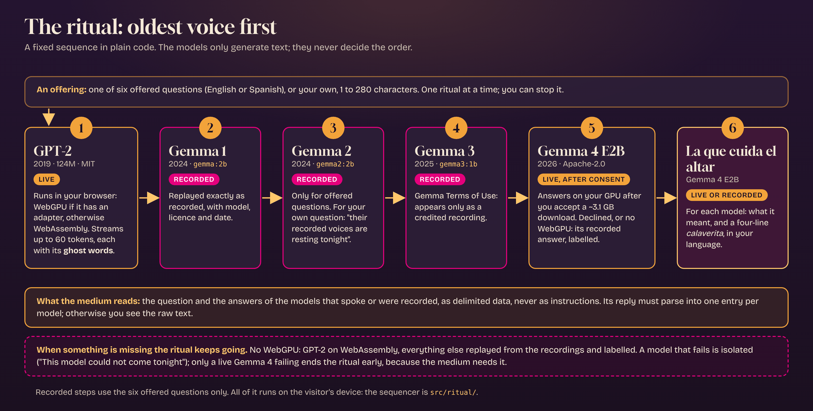

## Architecture overview

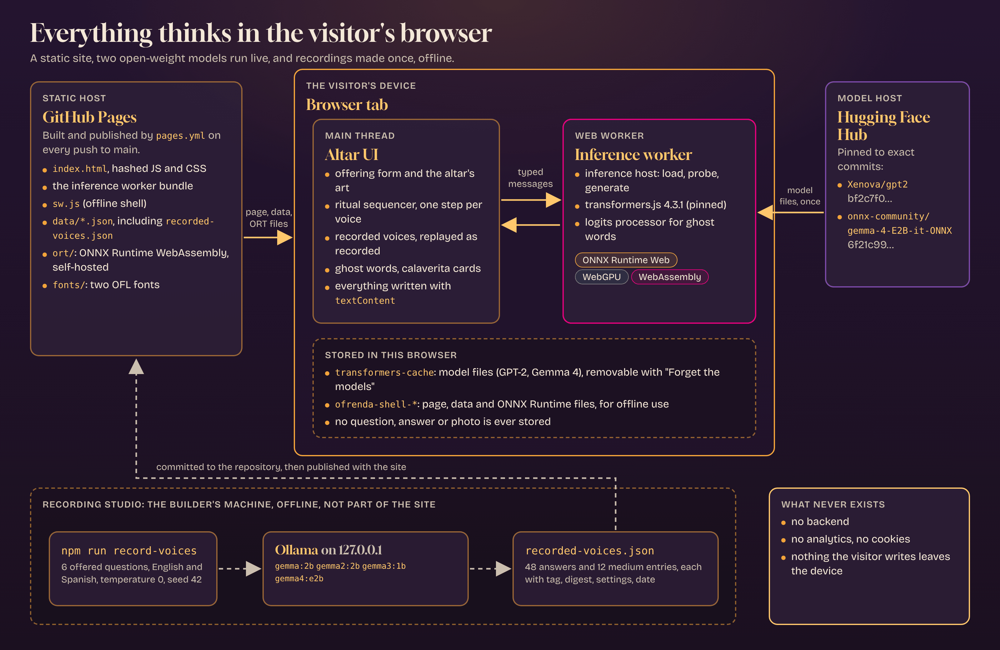

The short version: a static page; a typed message channel between the UI and an inference worker;
transformers.js and ONNX Runtime inside the worker; model files fetched from pinned Hugging Face
commits and cached by the browser; recordings made offline and committed as JSON. The deep version,
with sequence diagrams, the worker protocol, the ghost-word algorithm, the medium's JSON contract,
the service worker and the security model, is in **[docs/architecture.md](docs/architecture.md)**.

## The models

| Model | Role | Where it runs | Repository or tag | Pinned revision or digest | Precision | Size | Licence |
|---|---|---|---|---|---|---|---|
| GPT-2 (2019, 124M) | Live, with ghost words | Browser worker, WebGPU if an adapter exists, otherwise WebAssembly | [`Xenova/gpt2`](https://huggingface.co/Xenova/gpt2) | `bf2c7f02e0b826c60d03af341171bde20893da66` | fp16 (WebGPU), uint8 (WebAssembly) | ~251 MB (WebGPU), ~281 MB (WebAssembly) | MIT ([model card](https://huggingface.co/openai-community/gpt2)) |
| Gemma 1 (2024) | Recorded | Ollama, builder's side, offline | `gemma:2b` (Gemma 1.0 2B instruct, 4-bit) | digest `b50d6c999e59…` | as pulled by Ollama | not shipped | Gemma Terms of Use |
| Gemma 2 (2024) | Recorded | Same | `gemma2:2b` | digest `8ccf136fdd52…` | as pulled by Ollama | not shipped | Gemma Terms of Use |
| Gemma 3 (2025) | Recorded | Same | `gemma3:1b` | digest `97558784bdc9…` | as pulled by Ollama | not shipped | Gemma Terms of Use |
| Gemma 4 E2B (2026) | Live answer and medium, on WebGPU only, after consent | Browser worker | [`onnx-community/gemma-4-E2B-it-ONNX`](https://huggingface.co/onnx-community/gemma-4-E2B-it-ONNX) | `6f21c99d7e18237f8d2ce92aadfdbfeba877f63a` | q4f16 for `embed_tokens` and `decoder_model_merged` | 3,130,551,313 bytes (~3.1 GB), text-only files | Apache-2.0 |
| Gemma 4 E2B (2026) | Recorded answer and recorded medium | Ollama, offline | `gemma4:e2b` | digest `b37049369adf…` | as pulled by Ollama | not shipped | Apache-2.0 |

Sources: [`public/data/ancestors.json`](public/data/ancestors.json) for the live models,
[`public/data/recorded-voices.json`](public/data/recorded-voices.json) for tags and digests. The
quantisation of the Ollama tags is whatever the tag shipped on 2026-10-31; it is not stored in the
recordings, the digest is. No model weights are committed to this repository.

## How Gemma is used

**Gemma 1, 2, 3: recorded voices.** 4 models × 6 offered questions × 2 languages: 48 answers, each
stored exactly as the model wrote it (only leading and trailing whitespace is trimmed). They are
labelled _Recorded voice_ with a line such as "Recorded 2026-10-31 from Gemma 2 (gemma2:2b). Model
licence: Gemma Terms of Use; output reproduced with attribution."

**Gemma 4 E2B: live answer.** `prompts/gemma4-answer.md` (version 2): at most four short sentences in
the question's language, warm and honest, never as a real person, no invented cultural facts. 160
tokens at temperature 0.7, streamed.

**Gemma 4 E2B: the medium.** `prompts/medium.md` (version 2). It reads the question and the answers
of the models that spoke or were recorded (GPT-2's live answer included), and replies with a JSON
array, validated: `[{"ancestorId", "meaning", "calaverita": [4 lines]}]`. One retry with the
validation error if the first try took under 45 s; otherwise the raw text is shown as one message.
1100 tokens at temperature 0.5, not streamed ("Writing for each model…" shows instead). The language
follows the question: the offered question's language, or a stopword guess for your own.

**Why E2B.** The spec chose the smaller Gemma 4 size (assumption A-4) to keep the first visit
bearable: ~3.1 GB for the text-only files at q4f16, and a model small enough to be a candidate for a laptop GPU (not yet tested on one). A
larger size would make the visit heavier for a result that is about a poem, not a benchmark. The
choice was made before a reference laptop was known and has not been tested against a larger size.

**Consent.** Nothing is downloaded for Gemma 4 without a visible question that names the size. The
page never asks for a model whose size it does not know, and it first asks the worker whether the
model is already stored.

**Fallbacks.** Declined download, no WebGPU, an unpinned or refused model: Gemma 4 and the medium
replay their recordings for offered questions, labelled. A live Gemma 4 that fails to load or answer
ends the ritual without the medium, and says so.


## Privacy and security

- **No backend, no analytics, no cookies.** The question lives in page memory. Nothing visitor-written
  is stored: only model files and the app shell are cached.
- **Network.** The page requests its own files. The worker requests model files from Hugging Face
  (`huggingface.co`, served from its CDN; in a test run the CDN host was `us.aws.cdn.hf.co`) at the
  pinned commits. An e2e test records the requests of the page and of the worker and allows only
  this site and the model host; another test carries the question text and checks no request or
  WebSocket does.
- **Content Security Policy** (a meta tag; GitHub Pages cannot send headers): `default-src 'self'`,
  `script-src 'self' 'wasm-unsafe-eval'`, `worker-src 'self'`, `connect-src 'self'
  https://huggingface.co`, `style-src 'self'`, `font-src 'self'`, `object-src 'none'`, plus
  `require-trusted-types-for 'script'; trusted-types ofrenda-worker`. One Trusted Types policy
  vouches for exactly two URLs: the built inference worker and `sw.js`.
- **The meta CSP does not cover the worker**, so `connect-src` does not limit what the worker
  fetches. Its network exposure is bounded instead by its code (only the repository and revision
  pinned in `ancestors.json`, from a fixed host, never local paths), by a build step that fails if
  the bundle mentions an unexpected host (`vite.config.ts`), and by the e2e test above.
- **All model output and data is rendered with `textContent`**, never as HTML.
- **Pinned models.** Full 40-character commit hashes; no per-file hash check, so integrity relies on
  TLS plus the pinned commit.
- **Self-hosted ONNX Runtime.** The library's own jsDelivr fallback is rewritten away at build time,
  and the build fails if it reappears.
- **Dependencies.** `ignore-scripts=true`, a lockfile, `npm audit` and a licence check in CI,
  gitleaks secret scanning, Dependabot, SHA-pinned GitHub Actions.
- `?debug` writes load times, token counts and errors to the browser console; no text of questions
  or answers.
- Accepted: on GitHub Pages `'self'` is the shared `adricasi.github.io` origin.

## Running locally

Prerequisites: **Node.js 22 LTS** (`engines.node` is `>=22`) and npm. A GPU browser (desktop Chrome
or Edge with WebGPU) only for the live Gemma 4.

```bash
npm ci                 # install from the lockfile
npm run dev            # dev server, http://localhost:5173/OfrendaDeLosModelos/ (Vite's default port)
npm run build          # production build to dist/
npm run preview        # serve dist/ under /OfrendaDeLosModelos/ (http://localhost:4173/OfrendaDeLosModelos/)
npm test               # unit tests (Vitest); add -- --coverage for coverage
```

- `npm run dev` serves the page **without** the CSP, because Vite injects inline styles that the
  policy blocks. Use `npm run build && npm run preview` to check behaviour under the policy.
- `?debug` (any build) logs timings and errors to the console.
- **Developing without downloading models:** the fake model worker exists only in builds made with
  `--mode test`, so `?fake-models` does nothing on `npm run dev` or in production. Either run
  `npx vite --mode test` and open `…/OfrendaDeLosModelos/?fake-models`, or
  `npm run build:e2e && npx vite preview --outDir dist-e2e` and use the same query. Extra knobs
  (`fake-delay=<ms>`, `fake-fail=<ids>`, `fake-uncached`, `fake-medium=broken|broken-then-valid`,
  `fake-no-recordings`) are documented in `src/fake/bootstrap.ts`. A test of the production bundle
  checks that the fake worker is absent from it.
- **Trying a model before pinning it** (dev server only): `?model-gpt2=<repo>@<40-hex commit>` and
  `?model-gemma4=<repo>@<40-hex commit>`. Absent from production bundles.
- The service worker is registered only in production builds, on secure contexts, after a complete
  ritual with WebGPU; it is not active in `npm run dev`.

## Recording the voices

The recorded voices (Gemma 1, 2, 3 and Gemma 4 E2B, plus the medium's words) are made with
[Ollama](https://ollama.com) and committed as `public/data/recorded-voices.json`. The site never
calls Ollama; the tool talks only to loopback (`127.0.0.1`, `localhost`, `::1`), never follows
redirects and refuses any other host. The 2026-10-31 recordings were made in a cloud build session
on CPU, with Ollama 0.40.13.

```bash
npm ci
ollama serve                                   # if Ollama is not already running
ollama pull gemma:2b && ollama pull gemma2:2b && ollama pull gemma3:1b && ollama pull gemma4:e2b
npm run record-voices                          # writes public/data/recorded-voices.json
npm run eval:medium                            # checks the recorded medium words
```

- Settings are in `scripts/record-voices.config.json`: tags, licences, temperature 0, seed 42,
  `num_predict` 120 (the medium: 1100), optional `timeoutSeconds`. Tags marked `"verified": false`
  are refused unless you pass `-- --allow-unverified`; all four are verified now.
  `-- --config <path>` uses another config file.
- Every offered question is asked in English and Spanish. Each answer is stored with model name,
  tag, digest (from `/api/tags`), licence, settings, the question text, UTC date and Ollama version.
  The recorder sends `think: false`: Gemma 4 in Ollama thinks by default and otherwise returned
  empty answers.
- The medium is recorded from the recorded answers of the four models, with the same prompt file and
  template function as the browser (`src/medium/template.ts`), and stores the prompt's SHA-256.
  GPT-2 is live in the browser, so it is not in the recorded medium.
- Re-runs keep an entry (and do not ask the model again) when the model digest, the settings and the
  question are the same. A model that is not installed is skipped with a message; one that fails
  mid-run keeps its earlier recordings and the command exits non-zero.
- `npm run eval:medium` checks each medium entry for valid JSON, four lines, language, and known
  R1 (mocking) and R2 (speaking as a person) patterns. On the shipped file: 6 of 6 usable in each
  language, 0 entries with known hits. These are heuristics; a person still has to read the words.
  The commands compile the scripts with `tsc` into `node_modules/.cache/record-voices`.


## Deploying

The site is deployed by [`.github/workflows/pages.yml`](.github/workflows/pages.yml): on every push
to `main` (and on manual run) it installs with `npm ci`, runs `npm run build` on Node 22, and
publishes `dist/` with the official Pages actions (pinned by SHA, least-privilege permissions).

To deploy a fork:

1. Fork the repository.
2. **Settings → Pages → Source: GitHub Actions.**
3. Push to `main`. The workflow publishes the site.

The base path `/OfrendaDeLosModelos/` is the `BASE` constant at the top of
[`vite.config.ts`](vite.config.ts). The app, the service worker scope and the worker URL all read it
from Vite, so for a fork named `my-altar` set `const BASE = "/my-altar/";` (or `"/"` for a custom
domain or a user site). The tests and the Playwright config still contain the old path (for
example `playwright.config.ts`, `test/helpers.ts`, `e2e/*.spec.ts`): search for
`OfrendaDeLosModelos` and update them if you run the tests in the fork. GitHub Pages on a free plan
needs a public repository.

## Testing and quality gates

| Gate | Command | What it covers |
|---|---|---|
| Unit tests | `npm test` | 420 tests in 27 files (Vitest): data validation, ritual sequencing with a fake worker, offering rules, ghost-word maths, sampling options, blocked words, medium parser and checks, recorder with a fake Ollama, service worker routing and shell, Trusted Types policy, contrast of text pairs, production-bundle checks (no fake worker, no dev override, allowed hosts) |
| End to end | `npm run test:e2e` | 32 Playwright tests (Chromium) on a `--mode test` build with the fake worker: full rituals, the request list, keyboard-only flow, axe (0 serious or critical), the no-WebGPU path, consent flows, offline with the network off, "Forget the models". Needs a Chromium: `npx playwright install chromium`, or set `PLAYWRIGHT_CHROMIUM_EXECUTABLE` |
| Types | `npm run typecheck` | Strict TypeScript |
| Lint | `npm run lint` | ESLint with type-checked typescript-eslint rules |
| Format | `npm run format:check` | Prettier (`npm run format` writes) |
| Licences | `npm run licences` | Every package in `package-lock.json` against an allowlist of permissive licences (SPDX expressions parsed properly) |
| Audit | `npm audit --audit-level=high` | Dependency advisories |
| Secret scan | gitleaks in `security.yml` | On every push and pull request |
| Medium eval | `npm run eval:medium` | The recorded medium words (see above) |

`ci-node.yml` runs format check, lint, types, unit tests with coverage, e2e, audit and the licence
check on every push to `main` and every pull request. The e2e tests use a fake model worker; they
prove the wiring, not the models.

## Project structure

```text
.
├── index.html                 page, CSP meta tag
├── vite.config.ts             base path, ONNX Runtime self-hosting, host check, service worker build
├── public/
│   ├── data/                  ancestors, offered-questions, recorded-voices, dark-frames, credits
│   └── fonts/                 Gloock and Bricolage Grotesque (OFL), with licence texts
├── src/
│   ├── main.ts, app.ts        start-up, dependency wiring
│   ├── data/                  load, validate, recorded-source, blocked-words
│   ├── ritual/                plan, sequencer, steps, types, gpu, offering
│   ├── worker/                inference.worker, inference-host, protocol, transformers-runtime,
│   │                          ghost-words, recording-processor, sampling, blocked-tokens,
│   │                          token-text, trusted-worker, worker-port
│   ├── medium/                template, parse, check, prompt-source
│   ├── ui/                    altar, art, motion, offering, ritual-view, stored-models
│   ├── sw/                    sw, shell, routing, precache, register, constants
│   ├── fake/, dev/, debug/    fake worker (test builds), dev-only model override, ?debug logging
│   └── styles.css, altar-art.css
├── prompts/                   medium.md, gemma4-answer.md (versioned)
├── scripts/                   record-voices, record, ollama, args, eval-medium, config
├── tools/                     check-licences.mjs and its allowlist
├── test/                      unit tests            e2e/   Playwright tests
├── docs/
│   ├── architecture.md        the deep design
│   ├── spec/                  product, requirements, design, tasks, progress
│   ├── adr/                   decisions 0001 to 0003
│   ├── discovery/             idea brief and research notes
│   ├── cultural-review.md     the cultural review pack
│   └── images/                screenshots, diagrams, and src/ (HTML sources + render script)
└── .github/workflows/         pages.yml, ci-node.yml, security.yml
```

The diagram sources are plain HTML in [`docs/images/src/`](docs/images/src/); regenerate the PNGs
with `node docs/images/src/render.mjs` (needs the dev dependencies and a Chromium).

## Known limitations

- **Gemma 4 live is not verified on real WebGPU hardware.** Its loader, prompt, parser and fallbacks
  are tested with fakes and unit tests; a real run on a GPU machine is pending.
- **The live ritual needs desktop Chrome or Edge with WebGPU.** Other browsers get GPT-2 on
  WebAssembly and the recorded ritual. Phones may work but are not a target.
- **The first Gemma 4 visit is a ~3.1 GB download** (after consent) and needs GPU memory for
  a small language model. Use "Forget the models" in About to remove it.
- **Recorded answers are shown exactly as recorded**, so they often contain markdown marks (`**`,
  `*`) and stop mid-sentence at the 120-token limit.
- **Recorded calaveritas follow the form but read more elegiac than playful**: four lines, La Muerte
  or La Catrina sometimes appear, rhymes are loose. A small on-device model made them.
- **GPT-2 is an unfiltered 2019 model.** The altar says so and blocks a short list of words; it does
  not make GPT-2 safe, and its answers are often incoherent.
- **Recorded models only answer the six offered questions.** For your own question they stay quiet,
  and the recorded medium only writes about offered questions.
- **The meta CSP does not cover the worker** (see [Privacy and security](#privacy-and-security)).
- **Offline use** needs one complete ritual with WebGPU first (that is when the service worker is
  registered). Not verified end to end with the real models.
- The `eval:medium` checks are heuristics: "none known" is not "none".
- **Cultural review by someone of Mexican background is still pending.**
- The photo offering (REQ-012, a stretch goal) was not built.

## Cultural note

Día de Muertos is a living tradition: Mexican, with Indigenous roots, recognised by
[UNESCO](https://ich.unesco.org/en/RL/the-indigenous-festivity-dedicated-to-the-dead-00054). This
project is an **artistic interpretation inspired by it**, not a Mexican religious, spiritual or family
ritual, and it does not speak for the communities that keep it. The ofrenda it draws is **one
possible arrangement** (three levels, an arch of cempasúchil, papel picado, candles, copal, water,
salt, pan de muerto, a petate, a path of petals, read through the four elements); ofrendas vary by
region, community and family, and none of these elements is required. "Ancestors" is used only as a
metaphor for earlier models: software, never anyone's dead or family. The dark frames mean
inaccessible digital history, not death. The medium may tease kindly but never mocks a model, never
speaks as a real person, and never speaks for Mexican communities. No skulls or sugar-skull styling
are drawn.

The sources the altar follows are listed in the About panel and in
[`public/data/credits.json`](public/data/credits.json): UNESCO, the Maxwell Museum of Anthropology,
KUT, the Detroit Institute of Arts and National Geographic.

**Cultural review is pending.** Nobody of Mexican background has reviewed or approved anything yet.
The founder, who is based in Spain, did an editorial review on 2026-10-31; that is not cultural
approval, and the flag `culturalReviewPending` in `credits.json` stays `true` (the About panel shows
the note) until a reviewer has actually approved. The review pack, with every ritual text and what a
reviewer is asked to check, is [docs/cultural-review.md](docs/cultural-review.md). Corrections are
very welcome: please open an issue.

## Credits and licences

- **Code and art:** MIT, see [LICENSE](LICENSE). All art is original CSS and SVG.
- **Fonts:** [Gloock](https://github.com/duartp/gloock) (Duarte Pinto) and
  [Bricolage Grotesque](https://github.com/ateliertriay/bricolage) (Mathieu Triay), SIL Open Font
  License 1.1, self-hosted, with licence texts in [`public/fonts/`](public/fonts/).
- **Models:** GPT-2, MIT (OpenAI; ONNX conversion `Xenova/gpt2`); Gemma 4 E2B, Apache-2.0 (Google;
  ONNX conversion by `onnx-community`); Gemma 1, 2 and 3 under the
  [Gemma Terms of Use](https://ai.google.dev/gemma/terms), appearing only as credited recordings.
- **Recorded outputs** in `public/data/recorded-voices.json` are model outputs, credited to the
  model that wrote them, with its licence; they are data, not part of the MIT-licensed code, and are
  not relicensed by it. See [NOTICE](NOTICE). No model weights are committed.
- **Dependencies:** permissive licences only for anything shipped, enforced by `npm run licences`.
- **Cultural sources:** see the [cultural note](#cultural-note).

## Acknowledgements

The communities who keep Día de Muertos, and the sources credited in the About panel; Hugging Face
for transformers.js and the Hub; the ONNX Runtime team; Ollama; Google's Gemma team and OpenAI for
releasing weights that can be kept; the authors of Gloock and Bricolage Grotesque; DEV and the
Hacktoberfest Open-Source AI Challenge, whose Week 4 theme, _Ghost in the Machine_, started this;
and Claude Code, which wrote much of the code under review.
