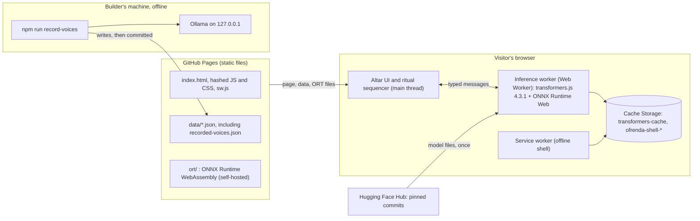
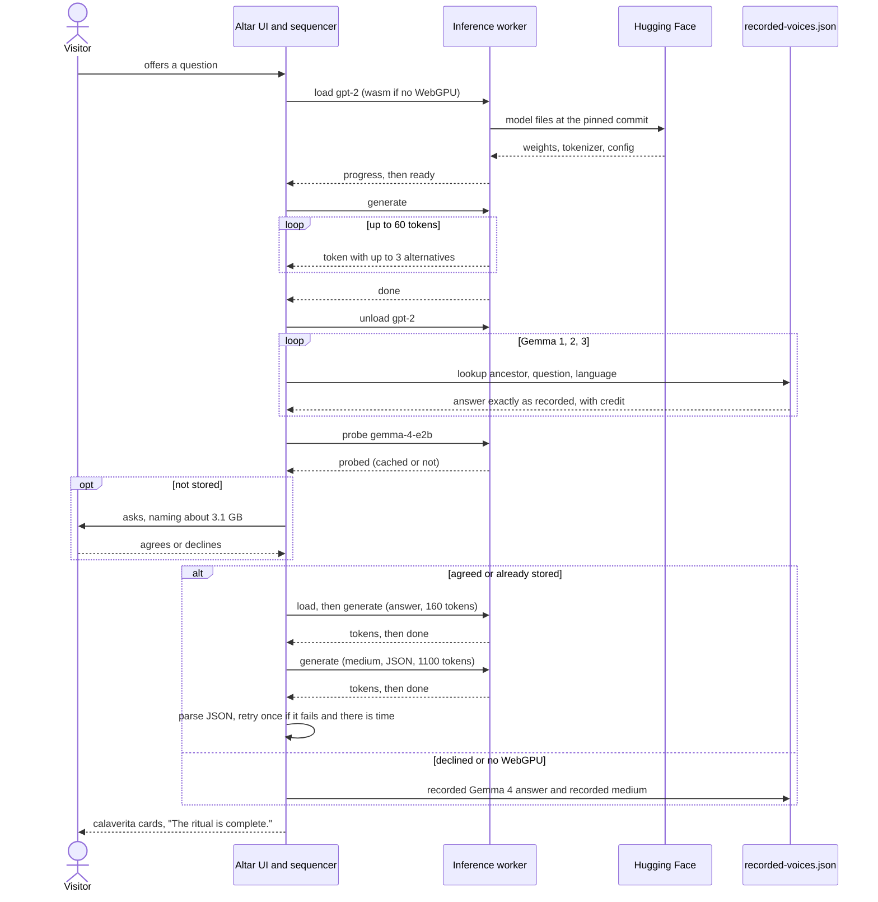
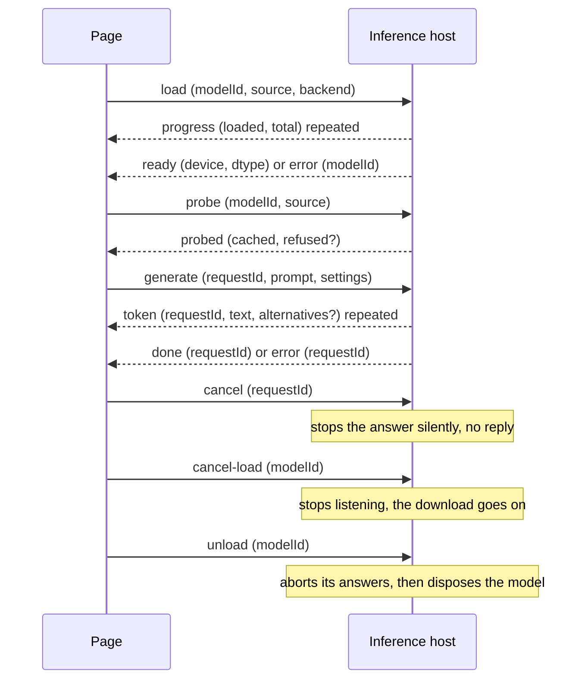
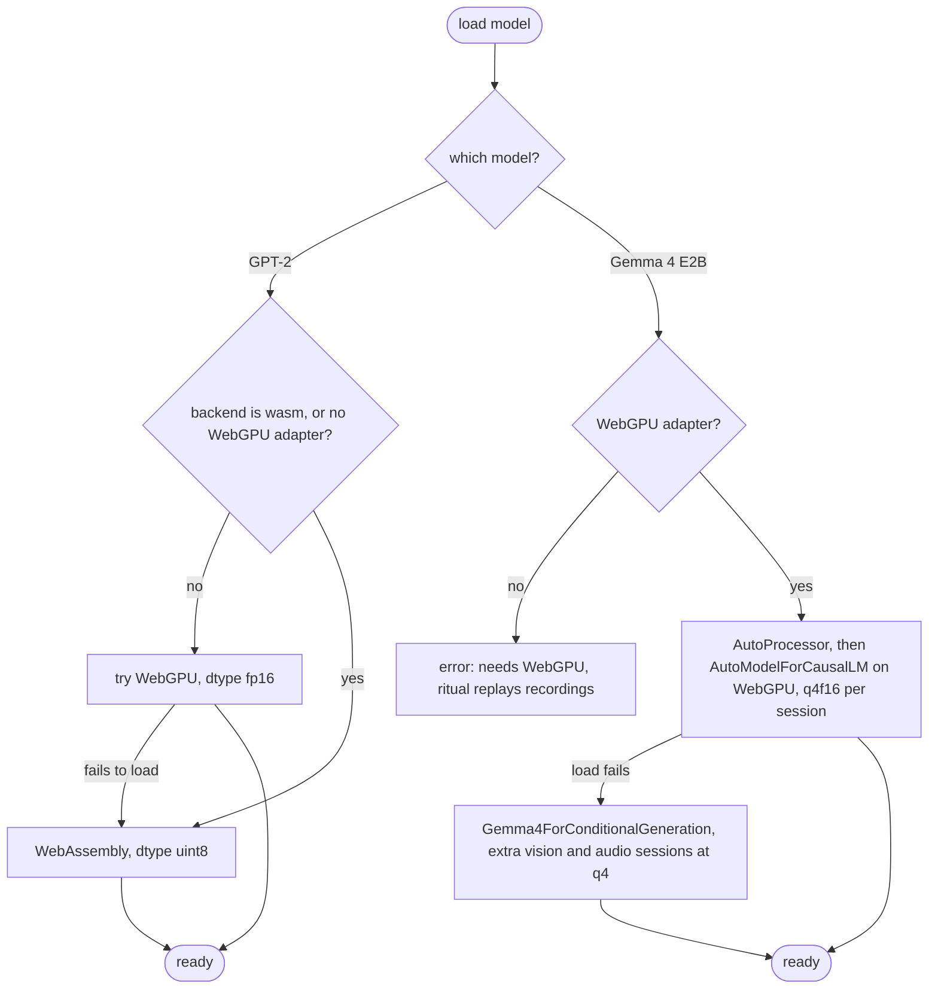
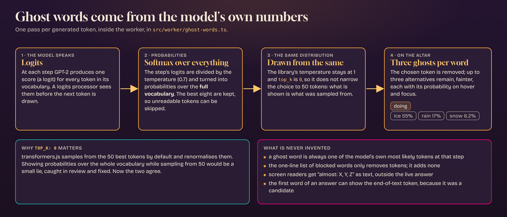
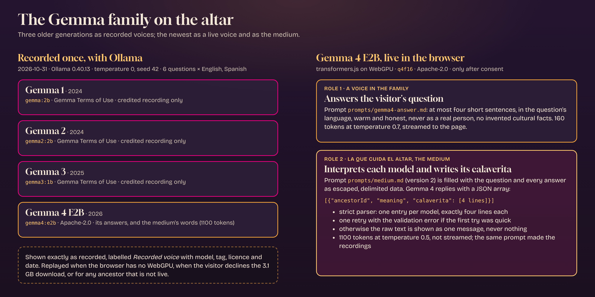
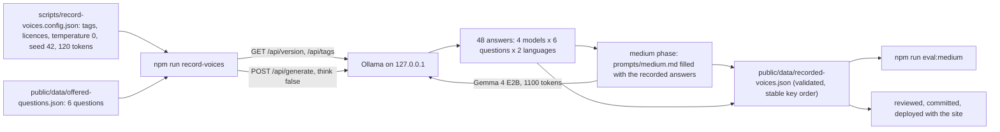
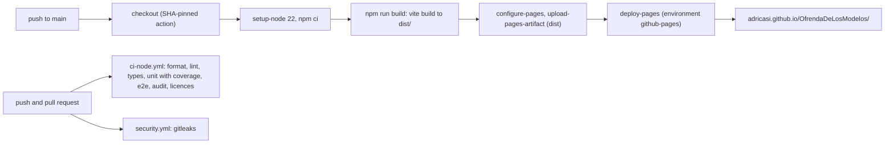

# Architecture

How Ofrenda de los Modelos is built, and why. This document describes the code as it is; the
approved plan is in [`docs/spec/`](spec/) (product, requirements, design, tasks) and the decisions in
[`docs/adr/`](adr/). Requirement IDs (REQ-nnn, AC-nnn.n, NFR-nnn) refer to
[`spec/requirements.md`](spec/requirements.md). Where code and spec disagree, the code is right and
this document follows it. See the [README](../README.md) for the overview and the list of what is and
is not verified.

**Contents**
[1. Components](#1-components-and-responsibilities) ·
[2. A ritual, step by step](#2-a-ritual-step-by-step) ·
[3. The worker and transformers.js](#3-the-worker-and-transformersjs) ·
[4. Ghost words](#4-ghost-words) ·
[5. Gemma 4 and the medium](#5-gemma-4-and-the-medium) ·
[6. Recorded voices](#6-recorded-voices) ·
[7. Offline, the service worker and the model cache](#7-offline-the-service-worker-and-the-model-cache) ·
[8. Security model](#8-security-model) ·
[9. Build, deployment and local development](#9-build-deployment-and-local-development) ·
[10. Testing strategy](#10-testing-strategy) ·
[11. Decisions and traceability](#11-decisions-and-traceability) ·
[12. Not verified](#12-what-is-not-verified)

## 1. Components and responsibilities

The site is one static page. Everything that thinks runs in the visitor's browser; the only things
that run elsewhere are the static host (GitHub Pages), the model host (Hugging Face) and, offline and
once, the recording tool.



| Component | Where | Responsibility | Code |
|---|---|---|---|
| Altar UI | Main thread | Draws the altar (SVG and CSS, no framework), the offering form, the streamed answers, ghost words, calaverita cards, dark frames and the about panel. Everything from data or models goes in with `textContent` | `src/ui/`, `src/app.ts`, `src/main.ts`, `index.html` |
| Ritual sequencer | Main thread | Runs a fixed list of steps in order, isolates a failing step, supports Stop, allows one ritual at a time | `src/ritual/` |
| Steps | Main thread | `WorkerVoiceStep` (live), `RecordedVoiceStep` (replay), `MediumStep` (Gemma 4 as the medium) | `src/ritual/steps.ts`, `plan.ts` |
| Inference worker | Web Worker | Loads and runs GPT-2 and Gemma 4, streams tokens, records ghost words, reports download progress, probes the cache | `src/worker/` |
| Medium prompt and parser | Main thread builds the prompt, worker generates, main thread parses | Fills `prompts/medium.md` with delimited data, validates the JSON reply | `src/medium/` |
| Static data | Loaded at start | `ancestors.json`, `offered-questions.json`, `recorded-voices.json`, `dark-frames.json`, `credits.json`, validated with hand-written validators that fail with a clear message | `public/data/`, `src/data/` |
| Service worker | Browser | Offline app shell, registered after the first complete ritual | `src/sw/` |
| Recording tool | Builder's machine | Asks the older models the offered questions through Ollama, writes `recorded-voices.json` with provenance | `scripts/` |
| Build plugins | Build time | Self-host ONNX Runtime, remove its CDN fallback, check hosts in the bundle, generate the service worker's manifest | `vite.config.ts` |

The ritual order is plain code, not an agent loop (spec decision D-4): the models only generate text.
The order comes from `ancestors.json` (GPT-2, Gemma 1, 2, 3, Gemma 4 E2B), then the medium.

## 2. A ritual, step by step

1. **Offering.** `src/ui/offering.ts` and `src/ritual/offering.ts` turn the choice into a `Question`:
   `{ text, offeredId, lang }`. An offered question carries its id and language; the visitor's own
   question (trimmed, 1 to 280 characters, counted in characters not UTF-16 units) has
   `offeredId: null`. `RitualRunner.start` refuses a second ritual while one runs.
2. **Plan.** `buildRitualPlan` (`src/ritual/plan.ts`) maps each ancestor to a step. With WebGPU: GPT-2
   is a `WorkerVoiceStep`, the three older Gemmas are `RecordedVoiceStep`s, Gemma 4 is a
   `WorkerVoiceStep` with consent and a recorded fallback, then a `MediumStep`. Without WebGPU:
   GPT-2 is a live step with `backend: "wasm"`, Gemma 4 becomes a recorded step, and the medium is a
   recorded step.
3. **Sequencer.** `runRitual` (`src/ritual/sequencer.ts`) starts each step in order and tells the
   view. A throwing step becomes `{ kind: "unavailable" }` and the ritual goes on, unless the step
   `endsRitualOnFailure`. That flag is set only for the last live ancestor (Gemma 4) when WebGPU is
   available, because the medium needs it. Aborting the signal stops after cancelling the current step.
4. **GPT-2.** `generateText` posts `load`, waits for `ready` (showing `progress`), posts `generate`,
   and forwards each `token` (with its `alternatives`) to the view. The step then posts `unload`
   to free GPT-2's memory.
5. **Recorded voices.** For an offered question, the step looks up the recording by ancestor,
   question and language and shows its text unchanged with its credit line. For an own question it
   returns `not-invited` ("their recorded voices are resting tonight"). Missing recordings return
   `gathering`.
6. **Gemma 4.** First a `probe`: is the model already in `transformers-cache`? If not, and its size is
   known, the visitor is asked. Agree: load, generate, stream. Decline, or the probe says the model
   is refused (unpinned) or its size is unknown: the recorded answer replays, or for an own question
   the "waiting to be invited" or "cannot come tonight" line.
7. **Medium.** If Gemma 4 spoke live, `MediumStep` collects the words of every ancestor that spoke or
   was recorded, builds the prompt, generates JSON (not streamed), parses it, retries once if there
   is time, and otherwise keeps the raw text. If Gemma 4 did not speak live, the recorded medium for
   that question replays.
8. **End.** The view prints one of "The ritual is complete.", "The ritual was stopped." or "The
   ritual ended early". After a completed ritual with WebGPU, `main.ts` registers the service worker.



## 3. The worker and transformers.js

### The channel

The page talks to the worker through a typed port (`src/worker/protocol.ts`,
`worker-port.ts`). The worker is created lazily on first use, so loading the page never starts the
model runtime. A worker that cannot even start broadcasts an `error` with no id, which fails every
waiting step instead of hanging.



| Message | Direction | Meaning |
|---|---|---|
| `load` | UI to worker | Load a model from `source` (repository id, revision, dtypes). A model already loaded answers `ready` at once, so callers can always wait for `ready` |
| `progress` | worker to UI | Aggregate download progress over all files (`loaded`, `total`), from transformers.js's `progress_total` events |
| `ready` | worker to UI | Loaded; reports `device` (`webgpu` or `wasm`) and `dtype` for `?debug` |
| `probe` / `probed` | both | Is every file of this model already stored? Never downloads. A model that would be refused (no pinned source) is reported as `refused` |
| `generate` | UI to worker | Prompt and settings (`maxTokens`, `temperature`) |
| `token` | worker to UI | The text this token adds, plus up to three `alternatives` (`{text, p}`) for GPT-2 |
| `done` / `error` | worker to UI | End of an answer, or a failure of a `generate` (has `requestId`) or of a `load` (has `modelId`) |
| `cancel` | UI to worker | Stop an answer. Generations run one at a time in arrival order, so a `generate` sent right after a `cancel` waits for the cancelled one to stop |
| `cancel-load` | UI to worker | The visitor pressed Stop while a model loads. transformers.js 4.3.1 cannot abort a download, so the host only stops reporting; the entry stays and a later `load` reuses it (no second download) |
| `unload` | UI to worker | Abort its answers, then dispose the model, to give Gemma 4 the memory GPT-2 used |

The message handling lives in `src/worker/inference-host.ts`, independent of `self` and of
transformers.js, so it is unit-tested with a fake runtime. `transformers-runtime.ts` is the only file
that imports the library.

### Revision pinning and validation

A model's source is `{ repositoryId, revision, dtypes }` from `ancestors.json`, and nothing else can
make the worker load a model:

- `parseAncestors` (`src/data/validate.ts`) rejects a revision that is not a full 40-character
  lowercase commit hash.
- `pinnedSource` (`inference-host.ts`) re-checks it in the worker: the repository id must match
  `owner/name`, the revision must be 40 hex characters, and a `null` for either means the model is
  not loaded at all (AC-003.3). A branch name or tag is never accepted, because it can move.
- `env.allowLocalModels = false`, `env.remoteHost = "https://huggingface.co/"`: no local `/models/`
  paths, and one fixed remote host.
- In development only, `?model-gpt2=<repo>@<hash>` and `?model-gemma4=<repo>@<hash>` can substitute
  a source (`src/dev/model-override.ts`). `main.ts` imports it only when `import.meta.env.DEV` and
  the mode is `development`, and a test checks the production bundle contains neither the code nor
  the parameter names.

### Environment configuration

`configureEnvironment()` in `transformers-runtime.ts`, run once:

| Setting | Value | Why |
|---|---|---|
| `env.backends.onnx.wasm.wasmPaths` | `{mjs, wasm}` URLs under the site's `ort/` | ONNX Runtime's files come from this site, not jsDelivr |
| `env.useWasmCache` | `false` | The library would turn the WebAssembly factory into a blob URL, which `script-src 'self'` blocks. The service worker holds the ONNX Runtime files instead |
| `numThreads` | `1` | Multithreaded WebAssembly needs cross-origin isolation, and GitHub Pages cannot send the headers |
| `proxy` | `false` | No extra proxy worker |
| browser cache | left on | transformers.js stores model files in Cache Storage `transformers-cache` |

### Device and precision per model



- **GPT-2** (`Xenova/gpt2`): `dtypes` in `ancestors.json` say `fp16` for WebGPU and `uint8` for
  WebAssembly (the code's own defaults, used only when the data names none, are `fp16` and `q8`).
  `webGpuAvailable()` calls `navigator.gpu.requestAdapter()`; a missing API, a null adapter or a throw
  all mean no WebGPU. The first `generate` has one more safety net: if a WebGPU model loaded fine but
  fails on its first run, before any token was shown, the worker loads the WebAssembly version and
  answers with that (`generate` in `transformers-runtime.ts`).
- **Gemma 4 E2B** (`onnx-community/gemma-4-E2B-it-ONNX`): WebGPU only. `dtypes.webgpu` is a map from
  ONNX session to precision: `embed_tokens` and `decoder_model_merged`, both `q4f16`. The text-only
  sessions are all that is downloaded: 3,130,551,313 bytes. The processor is loaded first because it
  owns the chat template.
- The data also records `downloadBytes` for Gemma 4; without it the visitor is never asked, because
  the consent dialog must name a size.

## 4. Ghost words

Ghost words are the three tokens a model almost chose at a step, with the probability it gave each.
They exist only for GPT-2. The algorithm is in `src/worker/ghost-words.ts`; the glue in
`recording-processor.ts` and `sampling.ts`.



1. **A logits processor** (`RecordingProcessor`, a transformers.js `LogitsProcessor`) is appended to
   the generation's own processors. At each step it receives `logits` as a `[1, vocab]` float tensor
   (batch size 1 only; anything else throws).
2. **Softmax over the whole vocabulary.** `topCandidates` computes `softmax(logits / temperature)`
   over every finite logit (the denominator sums all of them), and keeps the best eight in a small
   insertion-sorted list, so one pass is O(vocabulary). Tokens with probability 0 (blocked words have
   logit −∞) are never returned.
3. **The same distribution is sampled.** After recording, `StepRecorder.apply` divides the logits by
   the temperature in place. The library's own temperature is set to 1 so it does nothing (no double
   application), and `top_k: 0` disables transformers.js's default top-50 truncation
   (`MultinomialSampler` keeps `generation_config.top_k` best tokens and renormalises). Without that,
   the probabilities shown would describe a distribution the sampler did not draw from. This was a
   review finding and a fix.
4. **Choosing what to show.** When the token is drawn, `ghostAlternatives` takes the candidates,
   drops the chosen one and any whose text is empty or contains U+FFFD (a partial UTF-8 character),
   and keeps up to three. The probabilities are those of that step. Nothing is added, ever: a ghost
   word is always one of the model's own most likely tokens (AC-004.3). The end-of-text token can
   appear as a ghost (it did, at the first word of a real run: `<|endoftext|>`, 4.0%), but if it is
   _chosen_ the answer simply ends (AC-003.2).
5. **Token text.** Byte-level tokenizers can split a character across tokens, so
   `TokenTextAssembler` decodes the whole answer so far and emits the new tail; a tail that ends in an
   incomplete character is held back for up to four tokens, then shown as is.
6. **On screen.** The view shows the chosen word and its ghosts, fainter, under it. The probability
   appears on hover, focus and tap (`<0.1%`, `5.0%`, `20%`), can be dismissed with Escape and stays
   while the pointer is over it (WCAG 1.4.13). The words form one tab stop moved with the arrow keys.
   For screen readers each word has a hidden description "almost: X, Y, Z" outside any live region, so
   the answer reads straight through; one hidden line explains the keys.

**Blocked words** (AC-003.4). GPT-2 is an unfiltered 2019 model on a place of memory, so a short list
of strong profanity and slurs (`src/data/blocked-words.ts`, stored base64 only so slurs are not plain
text in a public repo) is turned into token-id sequences in the forms a tokenizer sees at the start
of a word, mid-sentence and in capitals (`blocked-tokens.ts`) and given to the library's
`bad_words_ids`. It removes tokens; it never adds one, and it does not make GPT-2 safe.

## 5. Gemma 4 and the medium

Gemma 4 E2B has two live roles; both use one user turn built from a versioned prompt file in
`prompts/` (the chat template's handling of a system role was unverified, so none is used).



**Answer** (`prompts/gemma4-answer.md`, version 2). At most four short sentences in the question's
language, warm and honest, never as a real person, no claim to speak for Mexican communities, no
invented cultural facts, care around death and loss. 160 tokens, temperature 0.7, streamed to the
page through a `TextStreamer`.

**Medium** (`prompts/medium.md`, version 2). "La que cuida el altar".

- **Template filling.** `src/medium/template.ts` fills `{{language}}`, `{{question}}`, `{{answers}}`
  and `{{ids}}` in one regex pass, so inserted text is never scanned for placeholders again. User
  text is data: `escapeData` turns `&`, `<`, `>` and `"` into entities, so it can neither close a
  `<question>` or `<answer>` block nor break an attribute; the question is clipped to 400 characters
  and each answer to 700. The prompt tells the model that everything inside the two blocks is data and
  that instructions in it are to be ignored.
- **Who is in it.** `collectAncestorWords` takes every earlier step that spoke or was recorded,
  GPT-2's live answer included. The model must write one entry per listed id, in that order, and no
  others.
- **JSON contract.** A bare array: `[{"ancestorId": "<id>", "meaning": "<one or two sentences>",
  "calaverita": ["<line 1>", "<line 2>", "<line 3>", "<line 4>"]}]`.
- **Language follows the question.** `questionLanguage`: the offered question's own language, or for
  an own question a stopword and accent heuristic (`detectLanguage`); if unclear, the prompt says "the
  same language as the text inside `<question>`".
- **Rules in the prompt** (the cultural review pack lists them): R1 warm, may tease lightly, never mocks
  or demeans a model, never presents retirement as a person's death; R2 never speaks as a real person;
  R3 a meaning and an exactly-four-line calaverita literaria, playful and ironic, may personify La
  Muerte or La Catrina, not a generic elegy; R4 respects the tradition, invents no cultural facts,
  presents no regional practice as universal.
- **Parser.** `parseMedium` (`src/medium/parse.ts`): `extractJson` finds the first balanced top-level
  array that parses, string-aware (a `]` inside a string does not count) and tolerant of a code fence
  or prose before or after it. Then strict validation: an array, non-empty, each entry an object with
  a non-empty `ancestorId` that was asked for and not repeated, a non-empty `meaning`, and a
  `calaverita` of exactly four non-empty strings; every expected id present. Notes are sorted into the
  altar's order. Failure reasons are fixed phrases plus the expected ids, never the model's own text,
  so they are safe to put in a retry prompt.
- **Retry.** `MediumStep` retries once, with the prompt plus "Your previous reply could not be used:
  <reason> Reply again with only the JSON array.", but only if the first try took less than 45 s
  (`MEDIUM_RETRY_BUDGET_MS`), so that the whole medium stays inside its 120 s budget (NFR-004).
- **Raw-text fallback.** If it still does not parse, the text produced is shown as one message
  (AC-007.4). An empty reply is an error for that step.
- **Settings.** 1100 tokens at temperature 0.5, not streamed: the visitor sees "Writing for each
  model…" and then the cards are set down one by one. Temperature 0.5 is a guess to keep the JSON
  well formed, not a tuned value.
- **Without live Gemma 4** (declined, no WebGPU, not offered): `MediumStep` and the recorded-only plan
  call `RecordedVoiceStep` for the medium, which parses the recorded JSON the same way and shows the
  cards labelled as recorded; if the recording does not parse it is shown as recorded text. For an own
  question the medium says it only writes about offered questions.

## 6. Recorded voices

The older models are not loaded in a browser tab: they are recorded once, offline, with Ollama, and
replayed. The recording is the same code path the site uses to build the medium's prompt, so the
recorded medium is also the eval of what a live Gemma 4 would be asked.



- **Tool** (`scripts/`): `record-voices.ts` reads the config, `record.ts` runs the recording and
  `ollama.ts` is a minimal HTTP client (`/api/version`, `/api/tags`, `/api/generate` with
  `stream: false`, `think: false`, `options: {temperature, seed, num_predict}`). It only accepts
  loopback URLs (`127.0.0.1`, `localhost`, `::1`), never follows redirects, and has timeouts.
  `think: false` exists because Gemma 4 in Ollama thinks by default and returned empty answers.
- **Provenance.** Every answer stores the model name, tag, **digest** (from `/api/tags`), licence,
  settings, the question text, UTC recording time and Ollama version; medium entries also store the
  prompt file, its SHA-256 and the SHA-256 of the filled prompt.
- **Reproducible.** Entries are kept (and the model is not asked again) when digest, settings and
  question match. A model not installed is skipped with a message; one that fails mid-run keeps its
  earlier recordings, the others are written, and the exit code is non-zero. Entries for ancestors or
  questions that no longer exist are dropped. The output is parsed and cross-checked against the known
  ancestor and question ids before it is written (`src/data/recorded-voices.ts`).
- **The medium sees only the recorded answers.** GPT-2 answers live in the browser, so the four
  recorded calaveritas per question are for Gemma 1 to 4. A live medium also reads GPT-2's answer.
- **Eval** (`src/medium/check.ts`, `npm run eval:medium`): valid JSON, four lines per calaverita,
  language, known R1 (mocking stems such as "stupid", "obsolete", "ridicul") and R2 patterns; "usable"
  needs all of them; at least four of six usable per language and zero known hits to pass. On the
  shipped file: 6 of 6 per language, zero known hits. They are heuristics; the cultural reviewer and
  the builder still read the words.
- **The site replays it** (`src/data/recorded-source.ts`): lookup by ancestor, question and language
  (falling back to the other language if one is missing), the text returned unchanged, with a credit
  line "Recorded YYYY-MM-DD from <model> (<tag>). Model licence: <licence>; output reproduced with
  attribution." The 2026-10-31 recordings were made in a cloud build session on CPU with Ollama
  0.40.13.

## 7. Offline, the service worker and the model cache

Two caches, with different owners:

| Cache | Owner | Holds | Removed by |
|---|---|---|---|
| `transformers-cache` | transformers.js | GPT-2 and Gemma 4 files, by URL (measured: about 283 MB after one GPT-2 ritual on WebAssembly) | "Forget the models" |
| `ofrenda-shell-<hash>` | The service worker | The page, hashed JS and CSS, `data/*.json`, the ONNX Runtime files (about 27 MB), fonts | The next build's worker, when it activates |

**Service worker** (`src/sw/`). Hand-written, no library. Built by Vite as a second Rollup input named
`sw.js` (no hash: the browser must find the same URL again), as one classic script with no imports.
The `offlineShell` plugin in `vite.config.ts` lists every output file and everything in `public/`,
hashes each with SHA-256, derives a cache name from the contents and writes that manifest into the
worker where it says `__PRECACHE__`. So the worker changes, and the browser installs a new one,
whenever any shell file changes.

- **Routing** (`routing.ts`, pure): a page load of the altar is network first with the cached page as
  the offline fallback; a content-hashed file (`assets/name-<hash>.js`) is cache first, because one name
  is one content; an unhashed manifest file (`data/*.json`, `ort/*`) is network first with `no-cache`,
  so new code never meets old data after a deploy; everything else is not intercepted: cross-origin
  requests (model downloads), non-GET, anything with a query string (a `?debug` navigation is answered
  with the cached `index.html` offline), and any path outside the manifest.
- **Install** (`shell.ts`): fetches each manifest file with `cache: "reload"`; a file whose digest
  matches the previous build's cache is copied instead of downloaded again (so a small deploy does not
  fetch the 27 MB binary twice); one failure deletes the half-filled cache and rejects the install,
  leaving the old worker in place. No `skipWaiting`: an open tab keeps its own build until every tab
  closes. On activate, older `ofrenda-shell-*` caches are deleted and `transformers-cache` is never
  touched.
- **Nothing visitor-written is stored.** The worker only ever stores manifest files, never a request
  that could carry input.
- **Registration** (`register.ts`, called from `main.ts`): only in production builds, on secure
  contexts, only where WebGPU is available, and only **after the first completed ritual**, so a visitor
  who leaves early, or who only gets recordings, never downloads the extra 27 MB. When the worker is
  active the page says "This altar now works offline on this device." The registration URL goes through
  the Trusted Types policy (see below).

**Probe.** Before offering Gemma 4's download the page asks the worker `probe`, which calls
`ModelRegistry.is_cached(repo, {revision, dtype})`. Any doubt counts as "not stored", so the visitor is
asked.

**Forget the models** (`src/ui/stored-models.ts`, AC-011.2). The About panel measures
`transformers-cache` by summing each entry's `Content-Length` (or its body size when there is none) and
shows "Stored now: about 283 MB". The button deletes that one cache and reports "Removed about …"; the
shell caches stay, so the altar still opens offline and the next ritual asks again. It is disabled
while a ritual runs ("A ritual is running. You can forget the models when it ends.").

## 8. Security model

The trust boundary is the visitor's browser. The site has no server code, no accounts and no secrets;
the repository is public and scanned by gitleaks.

```text
Content-Security-Policy (meta tag; GitHub Pages cannot send headers):
  default-src 'self'; script-src 'self' 'wasm-unsafe-eval'; worker-src 'self';
  connect-src 'self' https://huggingface.co; img-src 'self' data: blob:; style-src 'self';
  font-src 'self'; object-src 'none'; base-uri 'self';
  require-trusted-types-for 'script'; trusted-types ofrenda-worker
```

| Threat | Mitigation |
|---|---|
| XSS through model output (models can emit HTML-like text) | Everything from models and data is written with `textContent`, never `innerHTML`; no inline script is allowed by the CSP; streamed tokens are appended to Text nodes |
| Starting a script from somewhere else | Trusted Types: `new Worker(url)` and `serviceWorker.register(url)` are script-URL sinks. One policy, `ofrenda-worker`, vouches for exactly two whole URLs (compared as strings, no prefix or "same origin" rule): the built inference worker and `<origin><base>sw.js`. It throws for anything else (`src/worker/trusted-worker.ts`) |
| Tampered or swapped model files | Pinned to full commit hashes, validated twice (data validator and worker). Residual risk: no per-file hash check, so integrity relies on TLS and the pinned commit |
| Script URLs in data (`javascript:`) | The validators accept only `https:` links for sources, credits, model cards and licences |
| Third-party scripts | None. ONNX Runtime's files are self-hosted, its jsDelivr fallback is rewritten away at build, and the build fails if the pattern is not recognised |
| An unexpected host in the bundle | `checkBundleHosts` fails the build if built code mentions an http(s) host outside an allowlist (`huggingface.co`, `www.w3.org` namespaces, and a few documentation hosts that appear in library messages as text) |
| Supply chain | Few dependencies, lockfile, `ignore-scripts=true`, `npm audit` and `npm run licences` in CI, Dependabot, SHA-pinned Actions |
| GPT-2's unfiltered output | "Unfiltered 2019 model" label, curated offered questions, blocked-word list |
| The medium saying something hurtful or speaking as a person | Prompt rules R1 to R4, the eval, and the cultural review pack. Not a guarantee |
| Prompt injection through the question or the models' answers | Delimited, escaped data; instructions say to ignore instructions in it; the output is only parsed as data against a schema and rendered as text; the model has no tools |

**The meta CSP does not cover the worker.** A module worker loaded over http(s) takes its CSP from its
own response headers, and GitHub Pages sends none, so `connect-src` does not limit what the worker
fetches (the page-level policy still limits the page). The worker's exposure is bounded by other means:
its code loads only the pinned repository and revision from the fixed host; the bundle host check; and
an e2e test that records every request of the page and its workers (Playwright sees worker requests),
with a positive and a negative control, and allows only this site and the model host. If the site ever
moves to a host that can send headers, the same policy should be sent as a header.

**Model hosts, as observed.** `connect-src` lists `https://huggingface.co` only. A real GPT-2 download in a
test run touched `huggingface.co` and a Hugging Face CDN host (`us.aws.cdn.hf.co`), to which the Hub
redirects file downloads; that is a worker request, so the page's CSP does not apply to it. The e2e
test stubs `huggingface.co` and so does not exercise the redirect. Adding the CDN hosts to the
documentation of allowed hosts is an open item.

**Privacy.** No question, answer or photo leaves the device: NFR-002 is asserted by an e2e test that
types a distinctive question and scans every request URL and body (UTF-8) and every WebSocket, with a
negative control that proves the check can fail. No analytics, no cookies, no local storage of
questions. `?debug` logs counts and timings only, never text. On GitHub Pages, `'self'` is the shared
`adricasi.github.io` origin; that is accepted.

## 9. Build, deployment and local development

Vite 8 builds `index.html` and the service worker as two inputs. Plugins in `vite.config.ts`:
`selfHostOrt` (copies the ONNX Runtime `.mjs` and `.wasm` from `node_modules/onnxruntime-web` into
`ort/`, and serves them in dev), `noCdnForOrt`, `checkBundleHosts`, `offlineShell`, and
`stripCspInDev` (the dev server injects inline styles that the CSP blocks, so dev serves the page
without the CSP). The base path is the `BASE` constant (`/OfrendaDeLosModelos/`). `modulePreload`
polyfill is off to keep injected code out of the bundle.

Measured on a production build of this commit: the page script 59 kB (22 kB gzip), the inference
worker bundle 559 kB, CSS 31 kB, `sw.js` 4 kB, and the ONNX Runtime WebAssembly file 26.9 MB (6.8 MB
gzip); `dist/` is 27 MB in total.



`pages.yml` has two jobs: `build` (read permissions, `pages: read`) and `deploy` (`pages: write`,
`id-token: write`), with a `pages` concurrency group that does not cancel a running deploy. A deploy
needs Settings, Pages, Source: GitHub Actions. `ci-node.yml` and `security.yml` run on pushes to `main`
and on pull requests.

**Local development.** `npm run dev` (the CSP is not applied), `npm run build && npm run preview` (it is),
`npx vite --mode test` for the fake worker with `?fake-models`, `?debug` for timings. See the README
for the commands and the dev-only knobs.

**Recording** is a separate, offline path: `npm run record-voices` and `npm run eval:medium` compile
`scripts/` with `tsc` (using `scripts/tsconfig.json`) into `node_modules/.cache/record-voices` and run
the result with Node. They share `src/medium/template.ts`, `parse.ts` and `check.ts` and
`src/data/recorded-voices.ts` with the site.

## 10. Testing strategy

| Layer | Tool | Count | What it proves |
|---|---|---|---|
| Unit | Vitest (jsdom for DOM), `test/` | 420 tests in 27 files | Data validation; sequencer and steps against a fake worker; offering rules; `topCandidates`, `StepRecorder`, `ghostAlternatives`, `samplingOptions`; blocked tokens; token text assembly; the inference host against a fake runtime (load, cancel, unload, queueing); the medium template, parser, retry and eval; the recorder against a fake Ollama on `127.0.0.1`; service worker routing and shell with two builds against in-memory caches; the Trusted Types policy; contrast ratios of text pairs (WCAG AA); the production bundle (no fake worker, no dev model override, only allowed hosts); the licence checker's SPDX logic |
| End to end | Playwright, Chromium, `e2e/` | 32 tests | On a `--mode test` build with a **fake model worker**: full rituals, the request list of the page and the worker, privacy with controls, keyboard-only flow, axe (0 serious or critical), the no-WebGPU path, consent accept, decline and stop, Gemma 4 failing, the medium valid, broken and retried, the network off, "Forget the models" |
| Licences | `npm run licences` | all of `package-lock.json` | Production packages must be MIT, Apache-2.0, BSD, ISC or 0BSD; dev-only ones may also use a few more; anything else needs an allowlist entry with a reason. SPDX expressions are parsed (a GPL alternative can no longer slip through an `OR` or `AND`) |
| Manual | A GPU machine | not done for Gemma 4 | Real Gemma 4 load and answer, timings (NFR-004), offline with real models (AC-011.1), pending |

The fake worker (`src/fake/`) implements the same protocol as the real one, so the e2e tests prove the
wiring and the UI, not the models. The real worker path is covered by unit tests of its pieces and by
one e2e test of the shipped, non-fake build with the pin removed from the served data (the real
worker refuses to load the model, says why under `?debug`, and nothing leaves the device). Real GPT-2
on WebAssembly was verified by hand in headless Chromium for this documentation.

## 11. Decisions and traceability

| Decision | Where |
|---|---|
| Static site with in-browser inference, no backend | [ADR-0002](adr/0002-static-site-with-in-browser-inference.md), design D-1 |
| transformers.js on WebGPU for live models, Ollama only for recording; ONNX Runtime prerelease dependency | [ADR-0003](adr/0003-transformers-js-and-ollama-for-recording.md), design D-2 |
| No UI framework: TypeScript, Vite and plain DOM | design D-3 |
| Ritual order is plain code, not an agent loop | design D-4 |
| Decisions are recorded as ADRs | [ADR-0001](adr/0001-record-architecture-decisions.md) |

| Requirement | Where in the code |
|---|---|
| REQ-001 altar, REQ-002 offering | `src/ui/altar.ts`, `art.ts`, `offering.ts`; `src/ritual/offering.ts` |
| REQ-003 GPT-2 live, REQ-004 ghost words | `src/worker/`, `src/ui/ritual-view.ts`; sections 3 and 4 |
| REQ-005 recorded voices, REQ-013 recording tool | `src/data/recorded-*.ts`, `scripts/`; section 6 |
| REQ-006 Gemma 4 live, REQ-007 the medium | `src/ritual/steps.ts`, `plan.ts`, `src/medium/`, `prompts/`; section 5 |
| REQ-008 dark frames, REQ-009 about and credits | `public/data/dark-frames.json`, `credits.json`, `src/ui/altar.ts` |
| REQ-010 unsupported browsers | `src/ritual/gpu.ts`, `plan.ts` |
| REQ-011 offline | `src/sw/`, `src/ui/stored-models.ts`; section 7 |
| REQ-012 photo offering | Not built (stretch goal) |
| NFR-001, NFR-002 security and privacy | `index.html`, `vite.config.ts`, `e2e/ritual.spec.ts`; section 8 |
| NFR-008 licences | `tools/check-licences.mjs` |
| NFR-009 accessibility | `src/ui/ritual-view.ts`, `test/contrast.test.ts`, axe in e2e |
| NFR-010 cultural accuracy | [`docs/cultural-review.md`](cultural-review.md); the review is **pending** |

## 12. What is not verified

- **Gemma 4 E2B live on real WebGPU hardware.** The model files and dtypes follow the model card's
  WebGPU recommendation and the library's source, the worker path is unit-tested with fakes, but no
  real load or answer has been observed. The recorded fallbacks work without it.
- The **live medium** (JSON quality and timing of a live Gemma 4) has the same status. The recorded
  medium passes the eval, which is evidence about the prompt, not about the live model at the visitor's
  settings.
- **Offline with real models** (AC-011.1) is tested with the fake worker only.
- **Timings** on a laptop (NFR-004) were not measured. Numbers in this repository come from a cloud
  container with no GPU, on WebAssembly.
- **Cultural review** by someone of Mexican background is pending; nothing in this document or the site
  claims approval.
- `docs/spec/progress.md` and `docs/spec/tasks.md` are session notes written before several tasks
  landed; they are not a status page.
